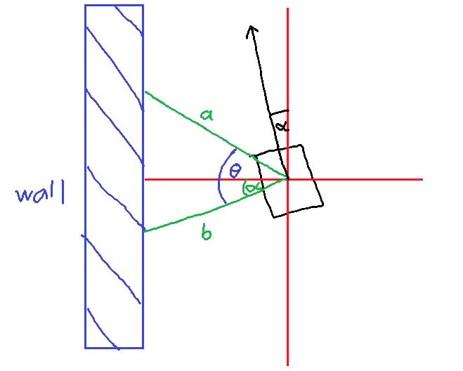

# Lab 2 Template
This lab will introduce you to Proportional–Integral–Derivative (PID) Controllers, which is a concept that allow your car to make correction smoothly based on how far it is from the desired raceline. The raceline used in this lab will be determined by following the wall, which the car stay a certain distance from the inner/outer wall. (Thus the name Wall Follow).

## Lab Objectives
- Learn how to implement a PID controller
- Learn basic reactive algorithm - wall follow
- Learn how to create a launch file to launch multiple nodes at once

## Lab Guide
### Step 1 Setup your workspace
1. Navigate to where you want to keep the lab workspace, preferably home.
~~~
cd
~~~

2. Clone this branch from GitHub using the following command:
~~~
git clone -b rp_lab2_template https://github.com/Roboracer-Purdue/roboracer-purdue rp_lab2_template 
~~~

3. Navigate into this lab's template
~~~
cd rp_lab2_template 
~~~
4. Type the following command to open the folder in VSCode (Get it installed if you are missing this part!)
~~~
code .
~~~

5. In VS Code, open `src/emergency_braking/emergency_braking/eb_template.py`
6. Copy your lab 1 code for emergency braking here
7. Open `src/wall_follower/wall_follower/pid_template.py`
8. This file is your source code, you will make changes to the wall follower node here.
### Step 2 Implementing Necessary Parameters
In `declare_all_params()`, declare the following parameters:

`wf_angle_a` : 45.0  
`wf_angle_b` : 90.0  
`wf_lookahead` : 1.0  
`wf_target_spacing` : 0.8  
`K_p` : 0.4  
`K_i` : 0.0  
`K_d` : 0.05  

Make sure to assign them to node variables in `load_params()` as well

### Step 3 Implementing Wall Follower
Wall follower is a type of reactive algorithm where your car will try to maintain a certain distance from the inner (or outer) wall. For simplicity, we will follow the inner wall while driving counter-clockwise in this lab, so the car will follow the left wall. One question to consider, is how can the car use LIDAR scans to measure how far it is from the left inner wall?

A simple approach is to read the LIDAR scan directly to the side (e.g., 90 degrees if the inner wall is on the left). However, this approach fails when the car is not parallel to the wall.

Hence, we will use two LIDAR scans to determine the heading the car, one pointing directly to the left (90 degrees), and one pointing slightly ahead (~45 degrees). Together, they can determine the car heading and its distance from the left wall.

Take a look at the following figure:

The car heading deviates from the parallel line by $\alpha$. The angular difference between the two scans (green lines) is $\theta$.

We can express car heading $\alpha$ as
$$
\alpha = \arctan{\left(\frac{a\cos{\theta}-b}{a\sin{\theta}}\right)}
$$

Then we can use the heading angle $\alpha$ to determine the distance from the wall

$$
D_t = b\cos{\alpha}
$$

Theoretically, this distance can be used to measure the deviation from target distance; however, this calculation is performed while the car is constantly moving, by the time the drive command reach the motor, it might be too late to steer. 

Hence, we will use predicted distance of distance $L$ ahead to calculate errors instead
$$
D_n = D_t + L\sin{\alpha}
$$

Then your error $e(t)$ can be computed from the difference between predicted distance and target spacing

$$
e(t) = D_n - target
$$

Implement the above concepts and calculations in step 1 of your control loop `def control_loop(self)`

### Step 4 Implementing PID

The following equation summarizes the PID controller that drive steering $u(t)$:
$$
u(t) = K_p e(t) + K_i \int_0^t{e(\tau)d\tau} \ + K_d \frac{d}{dt}(e(t))
$$
This equation can be overwhelming at first, so let's unpack it together

#### Proportional Error $e(t)$
This terms describe how much far the car is from the ideal raceline (which is a line parallel to the left wall with a certain distance between them).

If the car is too far from the wall ($e(t) > 0$) you want to left steer into the wall.

On the other hand, if the car is too close to the wall ($e(t) < 0$), you want to right steer away from the wall.

#### Derivative Error $\frac{d}{dt}(e(t))$
This terms describe how fast the car is getting away from the wall.

If the car is driving into the wall too quickly, the error term is decreasing rapidly ($\frac{d}{dt}e(t) << 0$). Adding the term $K_d \frac{d}{dt}e(t)$ will mitigate the left turn by turning "less" left for $K_d > 0$

Otherwise, if the car is driving away from the wall too quickly ($\frac{d}{dt}e(t) >> 0$), so adding the term will mitigate the right turn by turning "less" right.

Since our control loop does not fire every "infinitely small" time interval, you can approximate the derivative discretely using the following idea

$$
\frac{e(t) - e(t-\Delta t) } {\Delta t}
$$

#### Integral Error $\int_0^t{e(\tau)d\tau}$
This term accumulates the error $e(t)$ over time. And it tries to mitigate the overall error by affecting the steering slightly to counter the small errors accumulated from "non-ideal" turns.

If $\int_0^t{e(\tau)d\tau}$ is postive, the car has been driving too far from the wall on average, so next drive command should be slightly more left and vice versa.

Similar to derivative error, you can approximate the integral discretely using the following idea

$$
acc = acc \ + \ e(t)\Delta t  
$$

Note that during the first few seconds of your node execution, your car will be aligning itself with the ideal raceline, your integral accumulator should be off during these first few seconds. We recommend three seconds.

#### $K_p,K_i,K_d$ are Constant Coefficients
The K constants in the equation are the same as the K values you have set as your parameters. They essentially control how much each kind of error (Proportional, Derivative, or Integral) affects your output steering.

Take notes of how each errors affect your steering, and try to find a good K combination apart from the one given!

#### Code this
Implement the above ideas and finish the control loop. Feel free to increase the `max_speed` parameter to see what happen.

Similar to lab 1, the following command can be used to run the node
~~~
cd ~/rp_lab2_template
colcon build
source install/local_setup.bash   # Once per terminal

ros2 run wall_follower wall_follower
~~~

### Step 5 Create a Launch File for Your Node
Ideally, you would want to run your PID controller alongside the emergency braking node, so that when your algorithm fails, the car does not crash into the wall at full speed.

Luckily for us, ROS2 has a feature that allows us to launch multiple nodes with one command: Launch File.

#### Follow these steps to create a launch file

1. Create a new folder in `src/wall_follower` named `launch` using VSCode interface or the following commands:
~~~
cd src/wall_follower
mkdir launch
~~~

2. Create a new file in the `launch` folder called `pid_launch.py`

3. Copy the following template into that file, feel free to edit the parameters to your liking.
~~~
from launch import LaunchDescription
from launch_ros.actions import Node

def generate_launch_description():
    return LaunchDescription([
        Node(
            package='emergency_braking',
            executable='emergency_braking',
            name='eb_node',
        ),

        Node(
            # Wall Follower Node
            package='wall_follower',
            executable='wall_follower',
            name='pid_node',
            parameters=[{
                'max_speed': 2.5,
                'K_p': 0.4,
                'K_i': 0.0,
                'K_d': 0.05,
            }],
        ),
    ])
~~~

4. Your package do not know this launch file exist, go to `setup.py` and add this tuple to `data_files`:
~~~
('share/' + package_name + '/launch', ['launch/pid_launch.py']),
~~~
This ensures that your package can see the launch file.
5. Boot up a separate terminal, launch f1tenth_gym on it. This should be located in the testing_workspace you installed prior.
~~~
cd roboracer-purdue/roboracer_ws/
source install/local_setup.bash

ros2 launch f1tenth_gym_ros gym_bridge_launch.py
~~~
6. Build and launch our nodes with the launch file
~~~
cd ~/rp_lab2_template
colcon build
source install/local_setup.bash   # Once per terminal

 ros2 launch wall_follower pid_launch.py
~~~

Now we can test both our Emergency Braking and PID Controller at the same time!